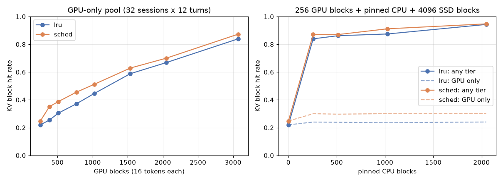
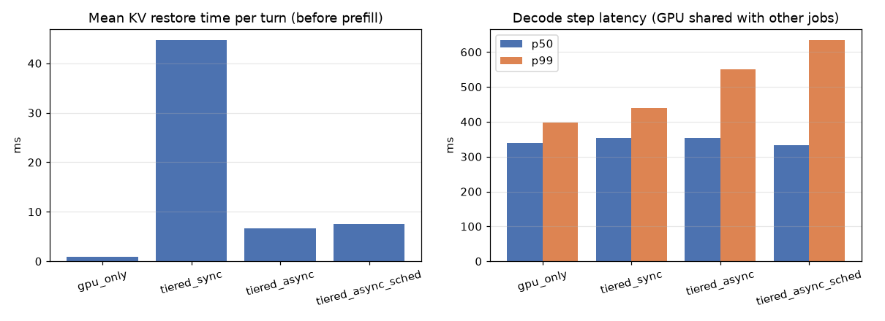

# Hierarchical KV-Cache Offloader

A from-scratch implementation (~1,500 lines of Python including benchmarks and tests) of the mechanism behind vLLM prefix caching + KV offloading,
LMCache, CachedAttention and NVIDIA Dynamo's KV Block Manager: a **paged KV-cache block manager with
three tiers** (GPU VRAM -> pinned CPU RAM -> NVMe SSD via memory-mapped files), **prefix-sharing hashes
with reference counts**, **LRU and scheduler-aware eviction**, and **asynchronous offload/prefetch on a side
CUDA stream** guarded by CUDA events. It drives a **real Qwen3-0.6B decode loop** whose attention reads
and writes K/V directly in the paged GPU pool, over a multi-session "agent" workload.

Everything in the results section was measured on one laptop (specs below). Where a number is analytic
or simulated, it says so.

---

## 1. The problem: KV cache is the memory of a conversation

During decoding, every layer attends over the keys and values of every previous token. Recomputing them
each step would cost a full prefill per token, so engines keep them: the **KV cache**.

```
bytes_per_token = 2 (K and V) x n_layers x n_kv_heads x head_dim x dtype_bytes
```

| Model | layers | KV heads | head_dim | bytes/token (bf16) | 128k-token context |
|---|---:|---:|---:|---:|---:|
| Qwen3-0.6B | 28 | 8 | 128 | 2*28*8*128*2 = **114,688 B = 112 KiB** | 14.0 GiB |
| Llama-3-70B (GQA) | 80 | 8 | 128 | 2*80*8*128*2 = **327,680 B = 320 KiB** | **40.0 GiB** |
| a 70B *without* GQA (64 KV heads) | 80 | 64 | 128 | 2,621,440 B = 2.5 MiB | 320 GiB |

**Worked example: 70B at 128k context.** 131,072 tokens x 327,680 B = 42,949,672,960 B = exactly **40 GiB**
for a single sequence, on top of ~140 GB of bf16 weights. An 80 GB H100 holding a tensor-parallel shard
of the weights can keep only a handful of such sequences. Grouped-query attention already bought an
8x reduction (64 -> 8 KV heads); without it one sequence would need 320 GiB. Paging + offloading attacks
the remaining problem: *capacity across many sessions*.

How long does it take to bring that 40 GiB back once it has left the GPU?

| Path | Bandwidth | Reload 40 GiB | Source of the bandwidth |
|---|---:|---:|---|
| PCIe 4.0 x16 | ~25 GB/s | 1.7 s | typical datacenter figure (analytic) |
| PCIe 5.0 x16 | ~50 GB/s | 0.86 s | typical datacenter figure (analytic) |
| **this laptop, pinned H2D** | **14.3 GB/s** | **3.0 s** | measured, `results/bandwidth.json` |
| **this laptop, SSD direct I/O read** | **1.98 GB/s** | **21.7 s** | measured, QD=1, 1.75 MiB requests |

Compare that to *recomputing* it: a 128k prefill of a 70B model is ~2 x 70e9 x 131k = 1.8e16 FLOP,
plus the quadratic attention term, i.e. tens of seconds on one H100. Moving bytes beats recomputing as soon
as the link is a few GB/s, which is the whole economic argument for KV tiers (CachedAttention, Mooncake,
LMCache), but only if the copy hides behind compute rather than stalling the decode loop.

`python -m kvoffload.kv_math` (with `src` on `PYTHONPATH`) prints these numbers.

### How much context fits on this machine (Qwen3-0.6B, 112 KiB/token)

| Tier | Budget | Tokens | 16-token blocks |
|---|---:|---:|---:|
| GPU (12 GB minus ~1.2 GB weights minus ~1.5 GB runtime) | ~9.3 GiB | ~87k | ~5.4k |
| pinned CPU RAM (half of 32 GB) | 16 GiB | ~150k | ~9.4k |
| NVMe SSD (200 GiB of the file system) | 200 GiB | ~1.87M | ~117k |

The SSD tier holds 20x more context than the GPU, but it reads ~7x slower than PCIe (measured).

---

## 2. Architecture

```mermaid
flowchart LR
  subgraph Control plane (pure Python, manager.py)
    H[hashing.py<br/>hash(parent, tokens)] --> I[(index: hash -> Block)]
    I --> M[BlockManager<br/>refcounts, per-tier free lists,<br/>per-tier eviction policy]
    S[Runtime / scheduler<br/>upcoming sessions] -- set_schedule / prefetch --> M
  end
  subgraph Data plane (transfer.py)
    G[GPU pool<br/>torch tensor in VRAM] <-- "cudaMemcpyAsync<br/>side stream + events" --> C[pinned CPU pool]
    C <-- "memcpy into np.memmap<br/>(worker thread)" --> D[SSD file]
  end
  M -- "engine.copy(src, slot, dst, slot)" --> G
  Q[PagedQwen3<br/>real model forward] -- "scatter new K/V,<br/>gather by block table" --> G
```

```
 sequence s3:  [sys0][sys1][sys2]...[u0][u1][t0][t1]...      <- logical blocks (16 tokens each)
                  |     |     |       |   |
 block table:   g7    g2    g9      g4  g0                     <- GPU slots (any order)
                  ^shared with s0,s1,s2 (ref=4)
 tiers:  GPU slots g0..gN   |   pinned CPU slots c0..cM   |   SSD slots d0..dK (mmap file)
         eviction: GPU victim -> CPU, CPU victim -> SSD, SSD victim -> dropped (recompute later)
```

### How the code maps to the theory

| Concept | Where | Notes |
|---|---|---|
| Paged blocks + block table | `manager.py` `Block.slots`, `qwen3_paged.py` | One block = all 28 layers x K/V x 16 tokens x 8 heads x 128 = **1.75 MiB contiguous**, so a tier move is *one* large DMA (the lesson of vLLM's 2025-26 offloading connector). |
| Prefix-sharing identity | `hashing.py` | `hash(parent_hash, tokens)`, SHA-256, full blocks only, optional per-tenant salt (vLLM APC). |
| Reference counting | `BlockManager.acquire/release` | ref > 0 pins the GPU copy; ref == 0 blocks stay cached and are only evicted when the slot is needed. |
| Inclusive hierarchy | `_demote`, `_promote` | Full blocks are immutable, so lower-tier copies never go stale: evicting a GPU block whose CPU copy exists is free. |
| Write-through offload | `commit(... write_through=True)` | As soon as a block fills, its D2H copy is queued on the side stream, overlapping with the next decode steps. |
| Prefetch | `Runtime.run_turn` -> `BlockManager.prefetch` | While session *i* runs, the blocks of the next scheduled session are lifted SSD->CPU->GPU. |
| Eviction policy | `policies.py` | `LRUPolicy` and `SchedulerAwarePolicy` (Belady-in-a-window over the scheduler's queue, as in CachedAttention). |
| Hazards without device syncs | `CudaKVEngine.copy/fence_gpu` | Copy stream waits on an event recorded on the compute stream at submit time; compute waits on the copy's event before touching that slot. The host blocks only if the worker has not *issued* the copy yet (that time is reported as `host_stall_s`). |
| SSD tier | `np.memmap` | SSD<->GPU always stages through a pinned CPU slot (no GPUDirect Storage on Windows). |
| Real decode | `qwen3_paged.py` | HF Qwen3 weights; attention data path is ours: scatter new K/V into the pool, gather by block table, SDPA with GQA. Verified against `model.generate` (slow test). |

---

## 3. Results (measured on this machine)

Hardware/software: NVIDIA GeForce RTX 5070 Ti Laptop GPU (Blackwell, sm_120, 12 GB), 32 GB RAM, NVMe SSD,
Windows 11 (10.0.26200), Python 3.12, torch 2.11.0+cu128, transformers 5.24.0. The machine was shared with
other jobs during measurement (a lock limits it to two GPU jobs at a time), so expect some noise.

### 3.1 Tier bandwidths (`benchmarks/bench_bandwidth.py`)

| Copy size | Host memory | H2D GB/s | D2H GB/s |
|---|---|---:|---:|
| 64 KiB | pinned | 0.85 | 0.98 |
| 64 KiB | pageable | 0.84 | 0.68 |
| 1 KV block (1.75 MiB) | **pinned** | **13.98** | **13.88** |
| 1 KV block (1.75 MiB) | pageable | 5.51 | 4.54 |
| 64 MiB | **pinned** | **14.32** | **14.16** |
| 64 MiB | pageable | 6.55 | 5.99 |

| SSD path (1 GiB, 1.75 MiB requests, QD=1) | GB/s |
|---|---:|
| `np.memmap` write + flush | 0.31 |
| `np.memmap` read (pages still in OS cache) | 5.34 |
| direct I/O write (`FILE_FLAG_NO_BUFFERING|WRITE_THROUGH`) | 1.47 |
| direct I/O read | 1.98 (0.93 ms per block) |

Lessons:
* **Transfer granularity dominates.** 64 KiB copies reach < 1 GB/s (fixed ~70 us launch/DMA setup cost);
  a 1.75 MiB all-layers block already gets 98% of peak. A per-layer layout (28 x 2 copies of 32 KiB each)
  would be ~15x slower, the same effect the vLLM team measured on H100.
* **Pinned memory is 2.3-2.5x faster** and is the only kind that allows truly asynchronous copies.
* **The laptop link is ~14 GB/s**, between a quarter and a half of what datacenter PCIe 5.0 x16 hosts quote.
* **SSD writes through a memory map are deceptive**: writes land in the page cache and only cost
  when flushed (0.31 GB/s with `FlushViewOfFile`); reads served from the page cache look like RAM.
  Direct I/O shows the device: ~2 GB/s read at queue depth 1, ~7x slower than PCIe.

Copy/compute overlap microbenchmark (bf16 4096^2 matmuls on the default stream vs 512 MiB of H2D on a
side stream, medians of 7 interleaved runs): compute alone 203 ms, copy alone 37 ms, **both 190 ms**:
the copy is fully hidden (the "both" run being *faster* than compute alone is clock/thermal noise on a
shared laptop GPU, so the reported hidden fraction of 1.36 should be read as "1.0, fully hidden").

### 3.2 Hit rates: LRU vs scheduler-aware, and what each tier buys (`benchmarks/bench_policy.py`)

Simulation with the *same* `BlockManager` and `Runtime` code and a `NullEngine` (no data moved):
32 agent sessions x 12 turns, a 256-token system prompt shared by all sessions, 128-token first user
message, 192-token tool output + 32-token reply per turn, random interleaving. A "hit" is a previously
computed block found in some tier when the session resumes; a miss must be recomputed by prefill.



| Configuration | LRU hit rate | Scheduler-aware hit rate | Recomputed tokens (LRU -> sched) |
|---|---:|---:|---:|
| GPU only, 256 blocks | 22.0% | 24.8% | 429k -> 414k |
| GPU only, 1024 blocks | 44.6% | 51.2% | 306k -> 270k |
| GPU only, 3072 blocks | 83.9% | 87.3% | 92k -> 74k |
| 256 GPU + 256 CPU + 4096 SSD | 84.0% | 87.1% | 92k -> 75k |
| 256 GPU + 1024 CPU + 4096 SSD | 87.4% | 91.2% | 74k -> 53k |
| 256 GPU + 2048 CPU + 4096 SSD | 94.3% | 94.7% | 36k -> 34k |

* A small GPU plus slow-but-big tiers matches a 12x larger GPU (256 GPU + 256 CPU + 4096 SSD ~ 3072 GPU blocks).
* Knowing the schedule helps most when capacity is tight (+6.6 points at 1024 GPU blocks, 12-28% less recompute) and
  fades once everything fits.

### 3.3 Real Qwen3-0.6B decode loop (`benchmarks/bench_decode.py`)

Workload: 6 agent sessions x 4 turns on **real Qwen3-0.6B** (bf16): a 256-token shared system prompt plus a
128-token user message, then 192 tokens of tool output and a 32-token greedy reply per turn, randomly
interleaved. Capacity is kept deliberately small so sessions evict each other: 128 GPU blocks (224 MiB),
128 pinned CPU blocks, 512 SSD blocks (1.75 MiB each). Same schedule and same inputs for every config.

| Config | GPU-tier hits | CPU / SSD hits | Lost blocks | Recomputed tokens | KV restore per turn | Host stall on copies | Decode step p50 / p99 | Tokens equal to `tiered_sync` |
|---|---:|---:|---:|---:|---:|---:|---:|---:|
| `gpu_only` (evicted = dropped) | 72.9% | - | 212 | **3,662** | 0.9 ms | 0 | 338 / 399 ms | 99.54% |
| `tiered_sync` (lazy write-back, blocking copies) | 74.7% | 106 / 92 | 0 | 270 | **44.7 ms** | 1.52 s | 354 / 440 ms | 100% (reference) |
| `tiered_async` (write-through + prefetch, side stream) | 98.8% | 9 / 0 | 0 | 270 | **6.6 ms** | 0.87 s | 318 / 375 ms | 100% |
| `tiered_async` (second run, paired with the next row) | 98.8% | 9 / 0 | 0 | 270 | 5.6 ms | 0.76 s | 354 / 551 ms | 100% |
| `tiered_async_sched` (+ scheduler-aware eviction) | 100% | 0 / 0 | 0 | 270 | 7.6 ms | 1.36 s | 333 / 634 ms | 100% |

The 270 recomputed tokens left in tiered configs are the partially filled tail blocks, which are never
hashed or shared by design; 270 tokens over 24 turns averages about 11 tokens per turn.



**What the run shows.**
* **The tiers eliminate recompute.** With GPU only, 212 evicted blocks had to be rebuilt by prefill
  (3,662 tokens). With CPU and SSD behind it, no block was lost. The 0.46% token difference of `gpu_only`
  is real too: a chunked re-prefill does not round bf16 exactly like the original token-by-token
  decode, so greedy outputs eventually diverge. Restoring bytes is *bit-exact*, recomputing is not.
* **Overlap moves the copy cost off the critical path.** Synchronous restore stalls each turn for
  44.7 ms on average (SSD reads plus H2D copies issued while the session waits). Prefetching the next
  scheduled session on the side stream while the current one decodes cuts this to 5.6-7.6 ms, because
  98.8-100% of the blocks are already on the GPU when the turn starts.
* **Decode step latency barely depends on the tier configuration.** Write-through D2H copies of
  freshly filled blocks run on the copy engine during compute. The step-time differences between rows
  (318-354 ms p50) are inside the noise of this run (see the warning below).
* **The scheduler-aware policy turned the remaining 9 CPU hits into GPU hits** (100% GPU-tier). At this
  small scale the effect on time is lost in noise; the simulation in 3.2 shows where it matters.

> **Warning about absolute times.** These runs shared the GPU with other heavy jobs (the GPU reported
> 99-100% utilisation from another process). `nvidia-smi` showed SM clocks between 922 and 2,160 MHz
> (3,090 MHz max) during the runs, and 180 MHz during an earlier attempt that was killed by the time limit. With the GPU to
> itself (late in an earlier, smaller 3-session run that was not kept), a decode step took about 49 ms p50. Treat the
> decode-step column as relative, within this table only. Hit counts, recomputed tokens, bytes moved and
> token agreement do not depend on contention. Each config ran once (or twice for `tiered_async`)
> because of the 15-minute limit per GPU job on this shared machine. Raw data:
> `results/decode_main.json`, `results/decode_sched.json`, plus per-turn CSVs.

---

## 4. How to run

```bash
pip install -r requirements.txt        # or reuse an env with torch + transformers
pytest -q                              # control-plane tests (no GPU) + tiny CUDA data-plane tests
RUN_SLOW=1 pytest -q                   # + paged Qwen3 forward == HF generate (downloads Qwen3-0.6B)
python benchmarks/bench_bandwidth.py   # tier bandwidths     -> results/bandwidth.json
python benchmarks/bench_policy.py      # hit-rate simulation -> results/policy_sweep.csv
python benchmarks/bench_decode.py --sessions 6 --turns 4 --gpu-blocks 128 --cpu-blocks 128 --ssd-blocks 512 --tag _main  # real decode loop -> results/decode_main.json + per-turn CSV
python benchmarks/plot.py              # PNGs for this README
```

Peak usage of `bench_decode.py` with these flags: ~1.7 GB VRAM, ~2.2 GB RAM, a 0.9 GB temporary SSD file (deleted at the end).

---

## 5. Limitations, and what production systems do differently

* **Attention is gather + SDPA**, not a paged-attention kernel: each layer copies the context's blocks
  into a contiguous tensor. vLLM/FlashInfer read blocks in-kernel. This inflates our step time, but it is
  the same for every configuration, so comparisons are fair.
* **Whole-session granularity for restore**: we bring all of a session's blocks to the GPU before its
  prefill. CachedAttention and LMCache pipeline loads *layer by layer* so layer *l* computes while layer *l+1*
  loads; InfiniGen prefetches only the tokens attention will need.
* **One copy thread, one copy stream, QD=1 SSD I/O.** Real systems use multiple DMA engines in both
  directions, io_uring/GDS (GPUDirect Storage) with deep queues, and NIXL/RDMA for remote tiers (Dynamo's G4, Mooncake).
* **Python control plane**: hashing and bookkeeping cost tens of microseconds per block, which is fine for
  a 0.6B model on a laptop but is why vLLM moved block management into tight, allocation-free code.
* **No compression** of lower tiers (KV quantization to FP8/INT4 halves or quarters the bytes moved),
  no radix-tree reuse at arbitrary (non-block-aligned) boundaries (SGLang), no cross-node sharing.
* **Synthetic token ids** in the workload (random ids from the vocabulary): hit rates depend only on the
  structure (shared prefix, turn lengths, interleaving), not on the text, so this is deliberate.
* Nsight was not used; timings come from CUDA events and `perf_counter` around synchronizations.

## 6. Exercises / next steps

1. Implement layer-wise restore: issue the H2D of layer *l+1* while layer *l* runs, using one event per layer.
2. Add an ARC or "cost-aware" policy that prefers evicting blocks that are cheap to recompute (short prefixes).
3. Quantize blocks to FP8 on their way to the CPU/SSD tiers and measure bandwidth vs. accuracy.
4. Replace `np.memmap` with unbuffered, overlapped I/O at queue depth 8-32 and re-measure the SSD tier.
5. Replace the gather+SDPA with a Triton paged-attention decode kernel and measure the step-time gain.

## 7. Further reading

See [docs/SOTA.md](docs/SOTA.md): PagedAttention/vLLM (arXiv:2309.06180), vLLM automatic prefix caching and
the KV offloading connector, SGLang RadixAttention (arXiv:2312.07104), CachedAttention (arXiv:2403.19708),
Mooncake (arXiv:2407.00079), LMCache (arXiv:2510.09665), NVIDIA Dynamo KVBM, InfiniGen (arXiv:2406.19707),
KVSwap (arXiv:2511.11907).

---

MIT License. Part of the series: https://github.com/Kripta-Studios/llm-inference-engineering-roadmap
